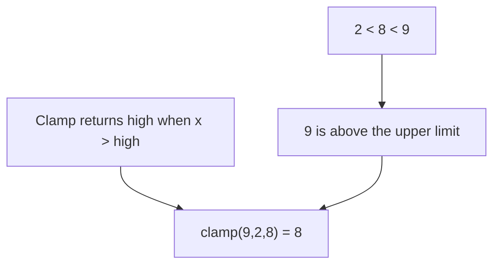

# Existing synthetic lesson note

Preserve this paragraph.

<!-- pi-md-log:01a12694-f8e8-7222-9720-cec22f74faec:start -->

> [!quote] YOU

> [!note] SKILL loaded: teach

This is a synthetic learner E2E test, not the real user's knowledge profile. Teach only the ordered-real-number clamp example in reference.md, using the original probe-plan-teach sequence. The student knows integer ordering but does not yet understand clamping. Use single-select quiz questions with short plain labels, and a single-select ask_user_question for the learning goal; this test student answers by keyboard. Keep the goal to clamp(9,2,8)=8. Probe only goal-relevant strands, then delegate reference verification to researcher, present the plan and wait for go-ahead. Then teach a short lesson, use quiz checks, and use /skill:visualize to delegate ONE Mermaid picture to coder; render, inspect, publish, and embed its PNG in the lesson. Treat the maker document as task instructions, not an additional role. At completion, say LEARN_WORKFLOW_COMPLETE. No network, credentials, dotenv files, environment dumps, dependencies, commits, or edits outside this fixture and visual staging. Subagent starts are automatically authorized.

> [!question] Quiz
> First, check the ordering we need. Which number is greater?
>
> 1. Equal
> 2. 8
> 3. 9

> [!success] Quiz — correct ✓
> Your answer: 3. 9
> Correct answer: 3
>
> $9 > 8$: 9 is greater than 8.

> [!question] Quiz
> What is $\operatorname{clamp}(9,2,8)$?
>
> 1. 9
> 2. 8
> 3. 2

> [!question] Quiz — I don't know
> Your answer: I don't know
> Correct answer: 2
>
> Clamp limits a number to the given range. 9 is above the upper limit, 8, so the result is 8.

> [!question] Quiz
> Check the gap more closely. Is 9 within the range from 2 through 8, including both limits?
>
> 1. Within the range
> 2. Above the range
> 3. Below the range

> [!success] Quiz — correct ✓
> Your answer: 2. Above the range
> Correct answer: 2
>
> $9 > 8$, so 9 is above the range. This comparison is the part we need before applying clamp.

> [!question] Question
> Which learning goal do you prefer?
>
> I recommend deriving the result from the limits, so you do not need to memorize it.
>
> 1. Understand why the result is 8 (Recommended)
> 2. Practice finding the result

> [!example] Answer
> 1. Understand why the result is 8 (Recommended)

> [!abstract] PI

You can identify that $9$ is above the range. The missing step is how clamp selects the result.

We will start with the limits, then connect the comparison to the clamp rule. Finally, you will explain why the result is $8$. The researcher verified the rule in `reference.md:2`.

The clamp rule is a definition, not a fact you must derive from ordering. We will use ordering to select the correct part of that definition.

> [!question] Question
> Shall we use this short plan?
>
> 1. Start the lesson (Recommended)
> 2. Change the plan

> [!example] Answer
> 1. Start the lesson (Recommended)

> [!abstract] PI

We need the limits to decide whether the input is permitted. Here, the lower limit is $2$ and the upper limit is $8$. The range includes both limits.

Your comparison, $9 > 8$, places the input above the upper limit.

> [!question] Quiz
> Which is the upper limit in $\operatorname{clamp}(9,2,8)$?
>
> 1. 8
> 2. 2
> 3. 9

> [!success] Quiz — correct ✓
> Your answer: 1. 8
> Correct answer: 1
>
> The arguments are input, lower limit, and upper limit. Thus 8 is the upper limit.

> [!abstract] PI

Clamp keeps the result within the limits. **Clamping** means leaving an input within the range unchanged, or replacing an input outside the range with the nearest limit (`reference.md:2`).

We already know that $9$ is above $8$. To bring it into the range with the smallest change, we stop at the upper limit, $8$. This is the rule: when the input exceeds the upper limit, return the upper limit.

The picture shows how the comparison selects the result. I inspected the published PNG.

![[viz-clamp-9-2-8-1791648790615.png|700]]

> [!question] Quiz
> When the input is above the upper limit, what does clamp return?
>
> 1. Lower limit
> 2. Input value
> 3. Upper limit

> [!success] Quiz — correct ✓
> Your answer: 3. Upper limit
> Correct answer: 3
>
> Clamp returns the upper limit for an input above it. Here, 9 exceeds the upper limit, 8.

> [!abstract] PI

Now connect the two facts: $9 > 8$, and an input above the upper limit returns that limit. Thus:

$$
\operatorname{clamp}(9,2,8)=8
$$

> [!question] Quiz
> What is $\operatorname{clamp}(9,2,8)$?
>
> 1. 2
> 2. 9
> 3. 8

> [!failure] Quiz — incorrect ✗
> Your answer: 1. 2
> Correct answer: 3
>
> 9 is above the upper limit, 8. Clamp therefore returns 8, not the input 9 or the lower limit 2.

> [!abstract] PI

The selected value, $2$, is the lower limit. But $9$ is above the range, not below it. Start at $9$ and move down: you reach the upper limit, $8$, first. Clamp stops there.

> [!question] Quiz
> Moving down from 9, which limit do you reach first?
>
> 1. 2
> 2. 8

> [!success] Quiz — correct ✓
> Your answer: 2. 8
> Correct answer: 2
>
> The order is $2 < 8 < 9$. Moving down from 9 reaches 8 before 2. Thus the nearest limit is 8.

> [!question] Quiz
> Apply that connection again. What is $\operatorname{clamp}(9,2,8)$?
>
> 1. 2
> 2. 8
> 3. 9

> [!success] Quiz — correct ✓
> Your answer: 2. 8
> Correct answer: 2
>
> $9 > 8$, so clamp returns the upper limit, 8. The lower limit, 2, does not apply to this input.

> [!abstract] PI

$\operatorname{clamp}(9,2,8)=8$: $9$ exceeds the upper limit, so clamp returns $8$.

You corrected the lower-limit error and passed the final check. The verified picture is saved in `viz/viz-clamp-9-2-8-1791648790615.png`.

LEARN_WORKFLOW_COMPLETE

<!-- pi-md-log:01a12694-f8e8-7222-9720-cec22f74faec:end -->
