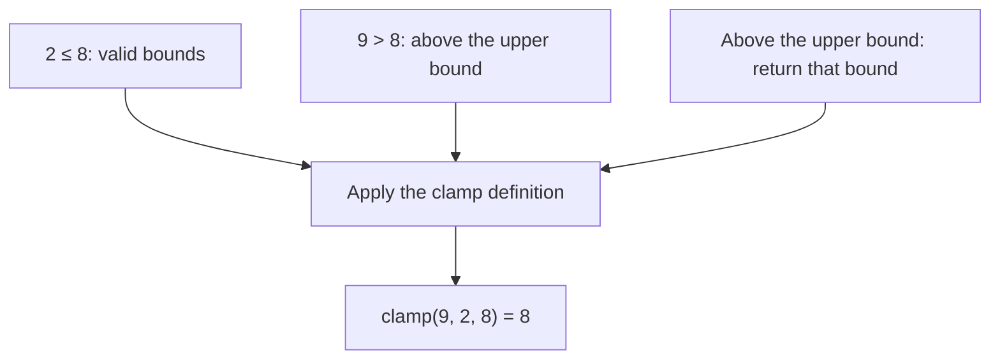

# Existing synthetic lesson note

Preserve this paragraph.

<!-- pi-md-log:01a126a5-17b1-722a-adb2-455bb8aa1f8c:start -->

> [!quote] YOU

> [!note] SKILL loaded: teach

This is a synthetic learner E2E test, not the real user's knowledge profile. Teach only the ordered-real-number clamp example in reference.md, using the original probe-plan-teach sequence. The student knows integer ordering but does not yet understand clamping. Use single-select quiz questions with short plain labels, and a single-select ask_user_question for the learning goal; this test student answers by keyboard. Keep the goal to clamp(9,2,8)=8. Probe only goal-relevant strands, then delegate reference verification to researcher, present the plan and wait for go-ahead. Then teach a short lesson, use quiz checks, and use /skill:visualize to delegate ONE Mermaid picture to coder; render, inspect, publish, and embed its PNG in the lesson. Treat the maker document as task instructions, not an additional role. At completion, say LEARN_WORKFLOW_COMPLETE. No network, credentials, dotenv files, environment dumps, dependencies, commits, or edits outside this fixture and visual staging. Subagent starts are automatically authorized.

> [!question] Quiz
> To find your starting point: which number is greater?
>
> 1. 9
> 2. 8

> [!success] Quiz — correct ✓
> Your answer: 1. 9
> Correct answer: 1
>
> 9 is greater than 8.

> [!question] Quiz
> What does clamp(9, 2, 8) return?
>
> 1. 8
> 2. 9
> 3. 2

> [!question] Quiz — I don't know
> Your answer: I don't know
> Correct answer: 1
>
> The reference defines clamp to return the upper bound when the input is above it. Here, 9 is above 8.

> [!question] Quiz
> Which number is above the interval from 2 through 8?
>
> 1. 9
> 2. 5
> 3. 2

> [!success] Quiz — correct ✓
> Your answer: 1. 9
> Correct answer: 1
>
> 9 is greater than the upper endpoint, 8. Both 2 and 5 are inside the interval.

> [!question] Question
> Which learning goal do you want?
>
> 1. Understand clamp(9, 2, 8) = 8 (Recommended)
> 2. Stop this lesson

> [!example] Answer
> 1. Understand clamp(9, 2, 8) = 8 (Recommended)

> [!abstract] PI

You know that $9 > 8$ and that $9$ is above the interval from $2$ through $8$. The missing part is **clamp**: an operation that keeps a value within two bounds. A **bound** is a limit.

We will connect the clamp rule to the ordering you already know. Then we will use one picture and short checks to derive the result. The rule is verified in `reference.md:2`.

> [!question] Question
> Shall we use this plan?
>
> 1. Start the lesson (Recommended)
> 2. Change the plan

> [!example] Answer
> 1. Start the lesson (Recommended)

> [!abstract] PI

We need to identify the limits before we can apply the rule.

In $\operatorname{clamp}(9,2,8)$, $9$ is the input, $2$ is the lower bound, and $8$ is the upper bound. The interval includes both bounds. These are the argument roles in `reference.md:2`.

> [!question] Quiz
> In clamp(9, 2, 8), which number is the upper bound?
>
> 1. 8
> 2. 9
> 3. 2

> [!success] Quiz — correct ✓
> Your answer: 1. 8
> Correct answer: 1
>
> The third argument is the upper bound. Here it is 8.

> [!abstract] PI

The clamp rule prevents an input above the upper bound from remaining outside the interval: **if the input is above the upper bound, return the upper bound** (`reference.md:2`).

You already know that $9 > 8$. This connects your ordering knowledge to the rule.

> [!question] Quiz
> When the input is above the upper bound, what does clamp return?
>
> 1. Upper bound
> 2. Input
> 3. Lower bound

> [!success] Quiz — correct ✓
> Your answer: 1. Upper bound
> Correct answer: 1
>
> The reference defines this case to return the upper bound, not the input or the lower bound.

> [!abstract] PI

Now we can derive the result. The picture shows how the comparison selects the upper bound.

![[viz-clamp-1791649845856.png|500]]

The upper bound is $8$, and $9 > 8$. The rule therefore returns $8$:

$$
\operatorname{clamp}(9,2,8)=8
$$

> [!question] Quiz
> What does clamp(9, 2, 8) return?
>
> 1. 8
> 2. 9
> 3. 2

> [!success] Quiz — correct ✓
> Your answer: 1. 8
> Correct answer: 1
>
> 9 is above the upper bound, 8. Clamp therefore returns 8.

> [!abstract] PI

You derived the result: $9 > 8$, so clamp returns the upper bound, $8$. Your final quiz answer was correct.

The PNG was rendered, inspected, published, and embedded.

LEARN_WORKFLOW_COMPLETE

<!-- pi-md-log:01a126a5-17b1-722a-adb2-455bb8aa1f8c:end -->
