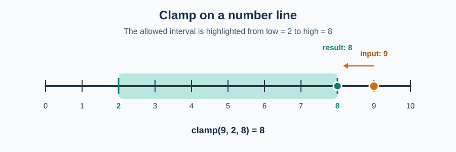

# clamp

A small Python function that bounds a value to an interval. No dependencies.

## API

```python
clamp(value, low, high)
```

Returns `value` bounded by `low` and `high`, inclusive.

- If `value < low`, returns `low`.
- If `value > high`, returns `high`.
- Otherwise returns `value` unchanged.
- If `low > high`, raises `ValueError("low must be less than or equal to high")`.

## Usage

```python
from clamp import clamp

clamp(13, 0, 10)   # 10
clamp(-3, 0, 10)   # 0
clamp(4, 0, 10)    # 4
clamp(10, 0, 10)   # 10
```

Invalid bounds are rejected:

```python
clamp(5, 10, 0)    # ValueError: low must be less than or equal to high
```

The picture below shows `clamp(9, 2, 8)`: the input `9` is outside the interval `[2, 8]`, so the result is `8`.



## Tests

The tests use only the standard library (`unittest`):

```sh
python -m unittest -v test_clamp
```
